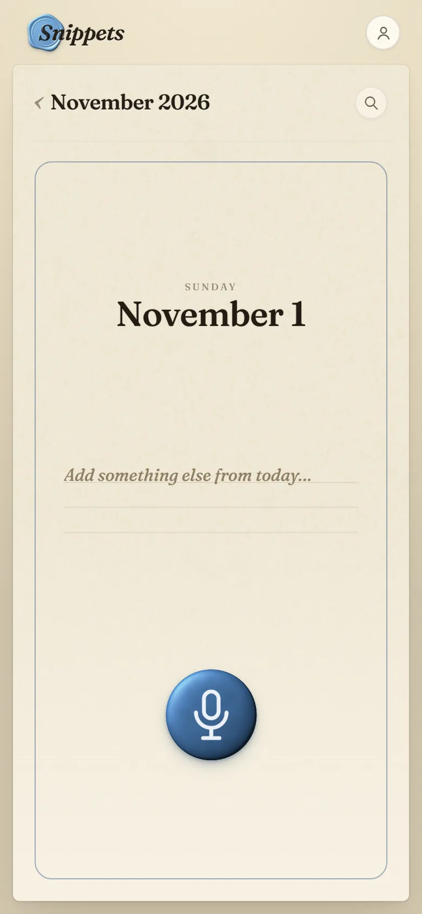
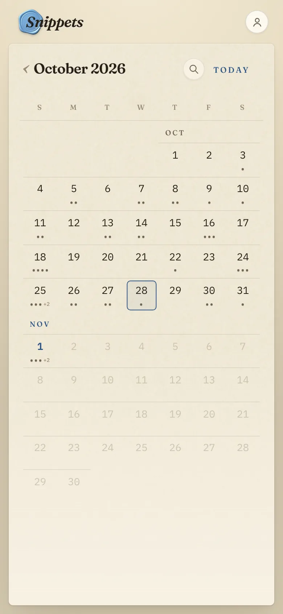
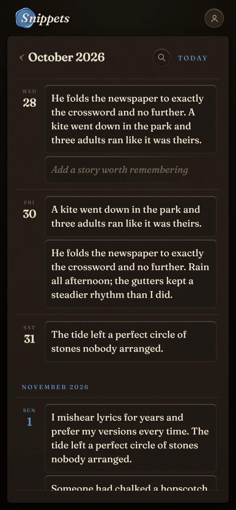
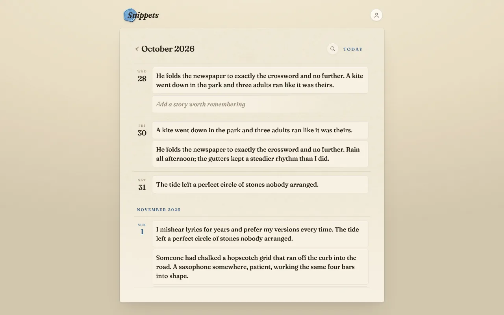

# Snippets

*A pocket notebook for the day's stories.*

Snippets is a journaling app for people who want to keep the small
moments of each day (a story, a joke, a line someone said) without
keeping a full diary. You speak or type a few words, and they land on
today's page in a book you can leaf back through by day, month, or
year. It runs in the browser, installs to a phone's home screen, works
offline, and keeps your entries on your device.

Live app: [www.snippets.ink](https://www.snippets.ink)

It follows the **Homework for Life** practice from Matthew Dicks's
*Storyworthy*: at the end of each day, keep the most storyworthy moment
that happened. Do it for a month, and you find that an ordinary life is
full of stories.

<p align="center">
  
  
  
</p>



The screenshots show invented sample entries from the app's built-in
seeder (`src/lib/dev-seed.ts`).

## What it does

- **Speak it or write it.** Tap the wax seal and talk. With a streaming
  speech key set, your words appear on the page as you speak, in any
  browser with a microphone. With a Whisper-compatible key instead, a
  recording becomes text about half a second after you stop. With no
  key, the browser's own speech engine streams the words (Chrome,
  Safari, Edge). Or type. Capture asks for no decisions.
- **Leaf back through.** Every entry sits in one book, grouped by day.
  Zoom out to a month calendar, where ink dots show how much you kept
  each day, or to a whole year. Search looks through every entry.
- **Yours alone.** Entries live in IndexedDB on your device, and you can
  export them to JSON or Markdown at any time. Typed entries stay on the
  device unless you sign in. Sign-in is optional and adds sync across
  devices: each entry is encrypted end to end on your device before it
  leaves, so the server holds only ciphertext that it can't read.
  Encryption is required at sign-in; there is no plaintext sync. Google
  Drive backup is opt-in and deliberately readable, as a safety net if
  you lose your key. Spoken audio leaves the device only to be
  transcribed.

## Run it locally

```sh
pnpm install
pnpm dev            # http://localhost:3000
```

### Optional speech keys

Every key is optional; the app works with none of them. Server-side
keys never reach the browser: the server mints a short-lived token for
each recording.

```sh
# Streaming providers: words appear as you speak. Set any subset.
# The default order is privacy-first: soniox, speechmatics, deepgram.
# The first provider with a key wins; the rest are automatic backups.

# Soniox (first by default): realtime and multilingual, switches
# language mid-sentence; audio is processed in memory, not stored, and
# not used for training. Token route: /api/soniox-token.
SONIOX_API_KEY=…
# SONIOX_MODEL=stt-rt-v5

# Speechmatics: realtime, stores neither audio nor transcript, EU
# endpoint; one language per session. Token route: /api/speechmatics-token.
SPEECHMATICS_API_KEY=…
# SPEECHMATICS_LANGUAGE=en

# Deepgram Nova-3: every request sends mip_opt_out=true, so audio is not
# kept for training. Token route: /api/deepgram-token.
DEEPGRAM_API_KEY=…
# DEEPGRAM_MODEL=nova-3
# DEEPGRAM_LANGUAGE=multi

# ElevenLabs Scribe v2 Realtime: outside the default order, because its
# zero-retention mode is enterprise-only. Token route: /api/scribe-token.
ELEVENLABS_API_KEY=…
# SCRIBE_MODEL=scribe_v2_realtime
# ELEVENLABS_BASE_URL=https://api.elevenlabs.io

# Provider order. Reorder and redeploy to switch; no code change.
# NEXT_PUBLIC_SPEECH_PROVIDERS=soniox,speechmatics,deepgram

# Batch fallback, used when no streaming key is set: any service that
# speaks the OpenAI Whisper API. The recording uploads when you stop.
# TRANSCRIBE_API_KEY=…
# TRANSCRIBE_BASE_URL=https://api.aquavoice.com/api/v1   # default: Aqua Avalon
# TRANSCRIBE_MODEL=avalon-v1.5
# (AQUA_API_KEY, AQUA_BASE_URL, and AQUA_MODEL still work as aliases.)
# Other Whisper-compatible services:
#   OpenAI  TRANSCRIBE_BASE_URL=https://api.openai.com/v1
#           TRANSCRIBE_MODEL=gpt-4o-transcribe
#   Groq    TRANSCRIBE_BASE_URL=https://api.groq.com/openai/v1
#           TRANSCRIBE_MODEL=whisper-large-v3-turbo
```

### Accounts, sync, and Drive backup (optional)

The app is complete without these. With them, signing in keeps an
encrypted copy of your entries on the server for sync across devices.
Entries are encrypted end to end on the device before they're sent, so
the server never holds readable text. Each signed-in device also writes
readable Markdown and a restorable JSON archive to a visible "Snippets"
folder in the user's own Google Drive. The server keeps no Drive
tokens, and the files stay with the user even if the app goes away.
Set these environment variables:

```sh
DATABASE_URL=…          # Neon Postgres (pooled URL); run pnpm db:migrate once
BETTER_AUTH_SECRET=…    # openssl rand -base64 32
BETTER_AUTH_URL=…       # the canonical origin
GOOGLE_CLIENT_ID/SECRET # Google sign-in and the Drive grant
RESEND_API_KEY/FROM     # sign-in codes and backup-failure alerts
CRON_SECRET=…           # guards /api/cron/backup (vercel.json schedules it)
OPS_ALERT_EMAIL=…       # optional: database storage alerts
```

One-time setup outside the repo:

1. Create the Neon project and run `pnpm db:migrate`.
2. In Google Cloud, create an OAuth web client with the redirect
   `…/api/auth/callback/google`, enable the Drive API, and put
   `/privacy` on the consent screen.
3. Publish the OAuth app to **Production**. In Testing status, Google
   expires refresh tokens after seven days, which stops backups.
4. Verify the Resend sending domain.

Sign-in uses only basic scopes. The `drive.file` grant is a separate
one-tap consent in **Settings → Backup**.

### Production

```sh
pnpm build && pnpm start
```

Deploys as-is to Vercel or any Node host. On a phone, open the site and
choose **Add to Home Screen**; it then opens like an app, offline
included.

## The design

A desk under lamplight with one sheet of paper on it. Paper and ink
carry the words, and sealing-wax blue marks recording, the margin rule,
and today. The full system (tokens, type voices, motion budget, and
copy voice) is in [`DESIGN.md`](./DESIGN.md), and the skills in
[`.claude/skills/`](./.claude/skills/) enforce it for agent
contributors.

| | |
|---|---|
| Stack | Next.js 16 · React 19 · Tailwind v4 · Dexie · Web Speech API |
| Data | Local-first (IndexedDB), soft delete with undo, JSON and Markdown export |
| Sync (optional) | Better Auth · Neon Postgres with Drizzle · end-to-end encryption |
| Typography | Fraunces (display and prose) · IBM Plex Mono (metadata) |

All rights reserved. The code in this repository is not licensed for reuse.
